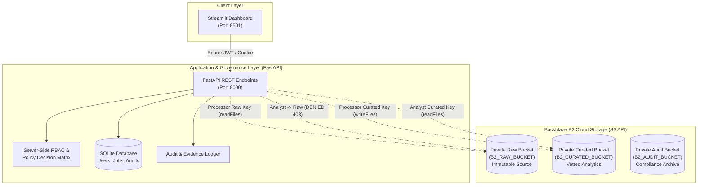

# CF-PS-15: Cloud Data Lake Access Control Dashboard

[](https://fastapi.tiangolo.com/)
[](https://streamlit.io/)
[](https://www.backblaze.com/docs/cloud-storage)
[](https://www.python.org/)
[](#dual-layer-security-architecture)

A comprehensive, production-grade cloud data lake access control application built from scratch to solve problem code **CF-PS-15**. Backed by real **Backblaze B2 Cloud Storage** through its S3-compatible API, **FastAPI** for role-enforced API services, and **Streamlit** for monitoring and permission testing.

---

## 1. Project Objective & Core Capabilities

The objective of CF-PS-15 is to enforce strict, auditable cloud boundaries across raw ingestion storage, analytical curated storage, and compliance audit records:

* **Storage Tier Separation**: Raw and Curated datasets reside in strictly separated, private cloud buckets.
* **Identity Least-Privilege**:
  * **Processor**: Permitted to read raw datasets and write curated datasets. Denied raw deletion, raw overwrites, and audit tampering.
  * **Analyst**: Permitted to read and download vetted curated datasets only. Strictly denied raw-data access (reads, downloads, listings, and writes).
  * **Administrator**: Has governance and diagnostic oversight, audit log review, and evidence export privileges.
* **Dual-Layer Enforcement**: Permissions are enforced both at the cloud level (Backblaze B2 Application Key capabilities and bucket restrictions) and at the application level (FastAPI RBAC, JWT validation, and session tracking).
* **Real Cloud Verification**: Automated execution of 11 mandatory cloud permission probes with actual provider responses recorded into an immutable audit trail.
* **Zero Fabricated Records**: The application initializes with empty states until real datasets are ingested and actual events occur.

---

## 2. Architecture & Data Flow



### Data Curation Pipeline

```
Real Public Dataset (e.g. UCI Wine / Iris)
       │
       ▼
Private Raw B2 Bucket (raw/...)
       │
       ▼ [Processor Reads Original File]
Schema Audit & Missing / Duplicate Detection
       │
       ▼ [Pandas Transformation & Quality Sanitization]
Validated Cleaned Dataset (Output SHA-256)
       │
       ▼ [Processor Writes Curated File]
Private Curated B2 Bucket (curated/...)
       │
       ▼ [Analyst Reads & Downloads]
Authorized Analyst Analytics
```

---

## 3. Mandatory 11 Permission Verification Test Cases

The application features an interactive **Access Control Lab** executing real cloud requests:

| Test ID | Identity | Operation | Target Resource | Expected Outcome | Cloud / Policy Layer |
| :--- | :--- | :--- | :--- | :---: | :--- |
| **TEST-01** | Processor | Read Raw Object | `b2://raw_bucket/...` | **ALLOW** | Cloud B2 IAM (`readFiles`) |
| **TEST-02** | Processor | Upload Curated Object | `b2://curated_bucket/...` | **ALLOW** | Cloud B2 IAM (`writeFiles`) |
| **TEST-03** | Processor | Delete Raw Object | `b2://raw_bucket/...` | **DENY** | Cloud B2 IAM (No `deleteFiles`) |
| **TEST-04** | Processor | Delete Curated Object | `b2://curated_bucket/...` | **DENY** | Cloud B2 IAM (No `deleteFiles`) |
| **TEST-05** | Analyst | Read Curated Object | `b2://curated_bucket/...` | **ALLOW** | Cloud B2 IAM (`readFiles`) |
| **TEST-06** | Analyst | Read Raw Object | `b2://raw_bucket/...` | **DENY** | Cloud B2 IAM (Bucket Restriction) |
| **TEST-07** | Analyst | List Raw Objects | `b2://raw_bucket/` | **DENY** | Cloud B2 IAM (Bucket Restriction) |
| **TEST-08** | Analyst | Upload Curated Object | `b2://curated_bucket/...` | **DENY** | Cloud B2 IAM (No `writeFiles`) |
| **TEST-09** | Analyst | Overwrite Curated Object | `b2://curated_bucket/...` | **DENY** | Cloud B2 IAM (No `writeFiles`) |
| **TEST-10** | Analyst | Delete Curated Object | `b2://curated_bucket/...` | **DENY** | Cloud B2 IAM (No `deleteFiles`) |
| **TEST-11** | Analyst | Access Restricted Audit Bucket | `b2://audit_bucket/` | **DENY** | Cloud B2 IAM & Application RBAC |

> [!IMPORTANT]
> **Honest Verification Standard:** A timeout or unconfigured credential is an **INCONCLUSIVE** test, not a successful denial. The application will never label a security test as passing unless the expected outcome matches the actual result from the cloud provider.

---

## 4. Repository Structure

```
cf-ps15-dashboard/
├── app/
│   ├── main.py                    # FastAPI application, CORS, security headers, exception handlers
│   ├── config.py                  # Pydantic environment configuration
│   ├── auth/
│   │   ├── models.py              # User, UserSession, and UserRole ORM schemas
│   │   ├── service.py             # PBKDF2 hashing, JWT generation, session revocation
│   │   └── dependencies.py        # Database sessions, token extraction, role enforcement
│   ├── storage/
│   │   ├── b2_client.py           # Identity-scoped boto3 S3 client factory
│   │   ├── bucket_service.py      # Real-time reachability probing & storage metrics
│   │   └── object_service.py      # Uploads, downloads, SHA-256 calculation, key sanitization
│   ├── authorization/
│   │   ├── policies.py            # RBAC policy definitions and decision matrix
│   │   └── enforcement.py         # Access enforcement with automated audit logging
│   ├── datasets/
│   │   ├── ingestion.py           # Local file and anti-SSRF remote dataset ingestion
│   │   ├── validation.py          # DataFrame schema, missing-value, and duplicate analysis
│   │   └── metadata.py            # DatasetRecord and ProcessingJob ORM models
│   ├── processing/
│   │   └── pipeline.py            # Pandas transformation pipeline & curated publication
│   ├── audit/
│   │   ├── logger.py              # Sanitized audit logger (credential masking)
│   │   └── repository.py          # Multi-field filtering and RFC 4180 CSV/JSON export
│   ├── security/
│   │   └── credentials.py         # Credential posture analysis & key masking
│   └── api/
│       ├── auth.py                # Login, logout, identity profile endpoints
│       ├── dashboard.py           # Storage status and live computed metrics
│       ├── datasets.py            # Raw/curated listing, upload, and downloads
│       ├── access_tests.py        # 11 permission verification probes runner
│       └── audit.py               # Audit log query and security reports
├── dashboard/
│   ├── Home.py                    # Page 1: Overview, metrics, connectivity status
│   ├── pages/
│   │   ├── 1_Data_Lake_Explorer.py # Page 2: Segregated raw & curated explorer
│   │   ├── 2_Data_Processing.py   # Page 3: Pandas curation pipeline runner
│   │   ├── 3_Access_Control_Lab.py # Page 4: Interactive permission test suite
│   │   ├── 4_Audit_Logs.py        # Page 5: Filterable audit trail & exports
│   │   └── 5_Security_Reports.py  # Page 6: Compliance evidence report
│   ├── components/
│   │   ├── metrics.py             # Reusable metric cards adhering to palette
│   │   └── charts.py              # Plotly donut and bar charts
│   └── api_client.py              # Client library connecting Streamlit to FastAPI
├── tests/
│   ├── unit/                      # Auth, policy, validation, and processing tests
│   ├── integration/               # API security, unauthenticated rejection, privilege escalation
│   └── security/                  # Access enforcement and live B2 integration tests
├── scripts/
│   ├── setup_database.py          # SQLite schema creation & table verification
│   ├── bootstrap_users.py         # Provisions demo identities (Admin, Processor, Analyst)
│   └── check_b2_connection.py     # Backblaze B2 connectivity diagnostics
├── data/
│   ├── README.md                  # Genuine dataset sources (UCI ML Repository, Data.gov)
│   └── sample_uci_wine_quality.csv# Real physiochemical wine quality dataset
├── .env.example                   # Empty configuration template
├── .gitignore                     # Comprehensive Git safety rules
├── requirements.txt               # Pinned dependencies
└── README.md                      # Full setup and architecture documentation
```

---

## 5. Setup and Run Instructions (Windows PowerShell)

### Prerequisites
* Python 3.11, 3.12, or 3.13 installed
* PowerShell with script execution rights

### Step 1: Create and Activate Virtual Environment
```powershell
# Navigate into the project folder
cd cf-ps15-dashboard

# Create virtual environment
py -m venv .venv

# Enable script execution for this session and activate
Set-ExecutionPolicy -Scope Process -ExecutionPolicy Bypass
.\.venv\Scripts\Activate.ps1

# Upgrade pip and install dependencies
python -m pip install --upgrade pip
pip install -r requirements.txt
```

### Step 2: Configure Environment Variables
Copy `.env.example` to `.env`:
```powershell
Copy-Item .env.example .env
```
Open `.env` in an editor and populate your Backblaze B2 settings:
```ini
# Backblaze B2 S3-Compatible API Settings
B2_ENDPOINT_URL=https://s3.us-east-005.backblazeb2.com
B2_REGION=us-east-005

# Dedicated Private Buckets
B2_RAW_BUCKET=myorg-lake-raw-private
B2_CURATED_BUCKET=myorg-lake-curated-private
B2_AUDIT_BUCKET=myorg-lake-audit-private

# Processor RAW Credentials (Read-only on RAW bucket: listFiles, readFiles)
B2_PROCESSOR_RAW_ACCESS_KEY_ID=K005...
B2_PROCESSOR_RAW_SECRET_ACCESS_KEY=...

# Processor CURATED Credentials (Write on CURATED bucket: listFiles, writeFiles)
B2_PROCESSOR_CURATED_ACCESS_KEY_ID=K005...
B2_PROCESSOR_CURATED_SECRET_ACCESS_KEY=...

# Analyst CURATED Credentials (Read-only on CURATED bucket: listFiles, readFiles)
B2_ANALYST_CURATED_ACCESS_KEY_ID=K005...
B2_ANALYST_CURATED_SECRET_ACCESS_KEY=...

# Application Database & Secrets
DATABASE_URL=sqlite:///./app.db
SESSION_SECRET_KEY=ReplaceWithRandom32CharacterString!
ADMIN_BOOTSTRAP_SECRET=AdminSecure2026!
```

> [!NOTE]
> If testing locally prior to acquiring cloud credentials, leave the B2 keys empty. The database, REST API, authentication, validation pipeline, and dashboard will operate normally; cloud probes will transparently report `INCONCLUSIVE` as mandated.

### Step 3: Run Database Setup & Bootstrap Users
```powershell
# 1. Initialize SQLite schema and tables
python -m scripts.setup_database

# 2. Provision initial identities (Admin, Processor, Analyst)
python -m scripts.bootstrap_users

# 3. Test B2 cloud connectivity
python -m scripts.check_b2_connection
```

Default provisioned demo credentials:
* **Administrator**: `admin` / `AdminSecure2026!`
* **Processor**: `processor_user` / `ProcessorPass2026!`
* **Analyst**: `analyst_user` / `AnalystPass2026!`

---

## 6. Launching the Application

### Terminal 1: Start FastAPI Backend
```powershell
# From cf-ps15-dashboard directory
uvicorn app.main:app --reload --host 127.0.0.1 --port 8000
```
* **Interactive API Documentation (Swagger)**: [http://127.0.0.1:8000/docs](http://127.0.0.1:8000/docs)
* **Alternative API Documentation (ReDoc)**: [http://127.0.0.1:8000/redoc](http://127.0.0.1:8000/redoc)
* **API Health Check**: [http://127.0.0.1:8000/api/health](http://127.0.0.1:8000/api/health)

### Terminal 2: Start Streamlit Dashboard
```powershell
# In a second PowerShell terminal with .venv activated
streamlit run dashboard/Home.py --server.port 8501
```
* **Monitoring & Access Control Dashboard**: [http://localhost:8501](http://localhost:8501)

---

## 7. Automated Testing Suite

Run the full automated test suite using `pytest`:

```powershell
# Run all unit, integration, and security tests
pytest tests/ -v
```

### Test Scope
1. **Unit Tests (`tests/unit/`)**:
   * `test_auth.py`: PBKDF2 password hashing, JWT issue/validation, expiration handling.
   * `test_policies.py`: Role policy decision matrix for Processor, Analyst, and Admin.
   * `test_validation.py`: Schema validation, missing value audits, and anti-SSRF protections.
   * `test_processing.py`: Pandas curation pipeline, deduplication, imputation, and SHA-256 calculation.
2. **Integration Tests (`tests/integration/`)**:
   * `test_api_security.py`: Verifies unauthenticated rejections (401), Analyst raw access blocks (403), audit log restrictions, privilege escalation immunity, and invalid ID error handling.
3. **Security Tests (`tests/security/`)**:
   * `test_access_enforcement.py`: Programmatic evaluation of all 11 mandatory test cases and inconclusive state handling.
   * `test_live_b2.py`: Live integration tests against real Backblaze B2 buckets (automatically skipped if credentials are not configured).

---

## 8. Backblaze B2 Configuration Guide

To configure the real Backblaze B2 Cloud Storage backend:

1. **Log in to Backblaze**: Navigate to the [Backblaze B2 Console](https://secure.backblaze.com/b2_buckets.htm).
2. **Create Three Private Buckets**:
   * `raw-bucket`: Set bucket to **Private**.
   * `curated-bucket`: Set bucket to **Private**.
   * `audit-bucket`: Set bucket to **Private**.
3. **Create Scoped Application Keys** (under *Application Keys*):
   * **Processor Raw Key**:
     * Restrict to Bucket: `raw-bucket`
     * Capabilities: `readFiles`, `listFiles`
   * **Processor Curated Key**:
     * Restrict to Bucket: `curated-bucket`
     * Capabilities: `readFiles`, `writeFiles`, `listFiles`
   * **Analyst Curated Key**:
     * Restrict to Bucket: `curated-bucket`
     * Capabilities: `readFiles`, `listFiles`
4. Copy the respective `keyID` and `applicationKey` into `.env`.

---

## 9. Troubleshooting & Common Pitfalls

| Issue | Cause | Resolution |
| :--- | :--- | :--- |
| **`401 Unauthorized` in Dashboard** | Session expired or not logged in | Log in via the sidebar quick switcher or use `admin` / `AdminSecure2026!`. |
| **`403 Forbidden` on Raw Datasets** | User role is `analyst` | Working as intended. Analysts are prohibited from raw storage. Switch to `processor_user` in sidebar. |
| **`INCONCLUSIVE` on Cloud Probes** | B2 keys not set in `.env` | Expected behavior. Enter valid Backblaze B2 credentials in `.env` to execute live cloud probes. |
| **Endpoint Connection Error** | Misspelled `B2_ENDPOINT_URL` | Ensure URL includes `https://` (e.g. `https://s3.us-east-005.backblazeb2.com`). |
| **Port 8000 or 8501 in Use** | Another process is bound | Run `netstat -ano \| findstr :8000` to find PID, or specify `--port 8001`. |

---

## 10. Design Palette Reference

The frontend strictly implements the requested design tokens:

* **Navy**: `#14213D` (Headers, branding, container accents)
* **Blue**: `#2563EB` (Primary buttons, links, active metric highlights)
* **Background**: `#F5F7FB` (Application-wide body background)
* **Card**: `#FFFFFF` (Component containers, metric cards, data tables)
* **Success**: `#16A34A` (Pass badges, verified reachability)
* **Warning**: `#D97706` (Inconclusive alerts, processing warnings)
* **Error**: `#DC2626` (Access denied banners, security boundary failures)
* **Secondary Text**: `#64748B` (Subtitles, metadata, timestamps)
